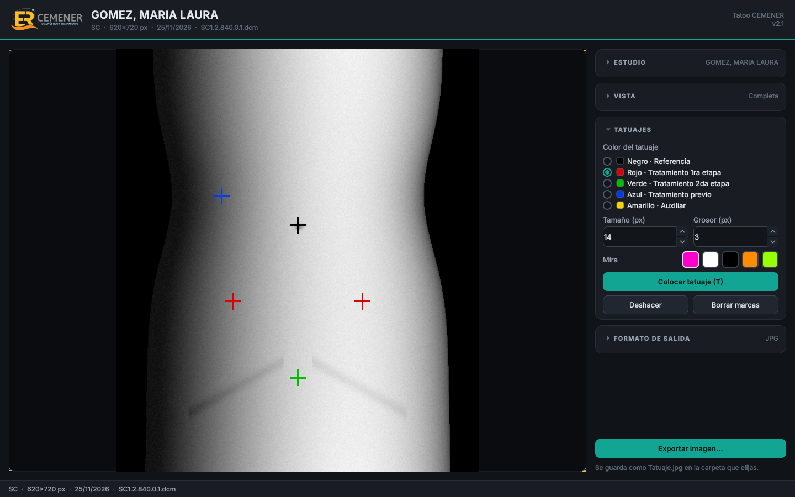
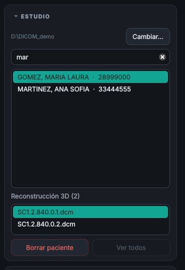
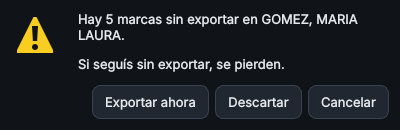

# Tatoo CEMENER

Aplicación de escritorio para marcar los puntos de tatuaje de referencia sobre la reconstrucción 3D de los estudios DICOM de radioterapia, y exportar la imagen marcada.

Desarrollada para el servicio de radioterapia de CEMENER (Fundación Centro de Medicina Nuclear y Molecular de Entre Ríos).



<sub>Las capturas usan pacientes e imágenes ficticios generados para la demostración.</sub>

---

## Descargar y usar

No hace falta instalar Python ni nada más.

1. Entrá a **[Releases](../../releases/latest)** y descargá `TatooCEMENER-windows.zip`.
2. Descomprimí la carpeta completa donde quieras (por ejemplo, en el Escritorio).
3. Abrí `TatooCEMENER.exe`.

> Importante: el `.exe` necesita el resto de los archivos de la carpeta. No lo saques de ahí; si querés tenerlo a mano, creá un acceso directo.

**Requisitos:** Windows 10 u 11 de 64 bits. No funciona en Windows 7.

La primera vez, Windows puede mostrar el aviso "Windows protegió su PC" porque el programa no está firmado. Hacé clic en **Más información → Ejecutar de todas formas**.

---

## Cómo se usa



1. **Paciente:** `Ctrl+F` y escribí el apellido o el DNI. La lista muestra el nombre del paciente y su DNI, ordenada por última modificación (los más recientes primero).
2. **Imagen:** se abre sola la reconstrucción 3D (archivos que empiezan con `SC`). Si el paciente no tiene, se muestran todas sus imágenes.
3. **Recortar** (opcional): `R` y arrastrá sobre la zona de interés. "Ver completa" vuelve a la imagen entera.
4. **Colocar tatuajes:** elegí el color en la sección *Tatuajes*, apretá `T` y hacé clic en cada punto. `Ctrl+Z` deshace la última marca.
5. **Exportar:** `Ctrl+E` o el botón *Exportar imagen…*, y elegí la carpeta. Se guarda como `Tatuaje.jpg` (el formato se cambia en *Formato de salida*).

<br clear="right">

Si intentás cambiar de paciente, de imagen o cerrar el programa con marcas sin exportar, la aplicación te avisa antes:



Las secciones del panel derecho arrancan plegadas y muestran un resumen (paciente, color y tamaño de la marca, formato). Se abren con un clic en el título.

### Colores de tatuaje

| Color | Uso |
|---|---|
| Negro | Referencia |
| Rojo | Tratamiento 1ra etapa |
| Verde | Tratamiento 2da etapa |
| Azul | Tratamiento previo |
| Amarillo | Auxiliar |

### Atajos de teclado

| Tecla | Acción |
|---|---|
| `Ctrl+F` | Buscar paciente |
| `T` | Colocar tatuaje |
| `R` | Recortar |
| `Ctrl+Z` | Deshacer última marca |
| `Ctrl+E` | Exportar |
| `Ctrl+O` | Cambiar carpeta DICOM |
| `Esc` | Cancelar el modo actual |
| `F11` | Pantalla completa |

### Carpeta DICOM

Al abrir, el programa usa la última carpeta que se eligió. Si no existe, prueba con la carpeta DICOM por defecto del servicio, y si tampoco está disponible, pide elegir una (`Ctrl+O`). La elección queda guardada para la próxima vez.

### Qué guarda el programa en la PC

Nada se guarda junto a los estudios: las carpetas DICOM solo se leen.

- Carpeta elegida: registro de Windows del usuario (`HKCU\Software\CEMENER\TatooCEMENER`).
- Pacientes ocultos con "Borrar paciente": `%USERPROFILE%\.tatoo_cemener_ocultos.json`. Ocultar un paciente **no borra** su carpeta.
- Nombres de paciente ya leídos (para que la lista abra rápido): `%USERPROFILE%\.tatoo_cemener_nombres.json`.

---

## Para desarrollo

### Correr desde el código

Con Python 3.10 o superior:

```
py -m pip install -r requirements.txt
py tatuajes.py
```

### Generar el ejecutable

```
py -m pip install -r requirements.txt pyinstaller
py -m PyInstaller TatooCEMENER.spec --noconfirm
```

El resultado queda en `dist\TatooCEMENER\`. Hay que distribuir la carpeta completa, no solo el `.exe`.

### Publicar una versión nueva

El ejecutable se compila solo en GitHub cada vez que se sube un cambio de la app a `main`:

1. Cambiá `APP_VERSION` en `tatuajes.py` (por ejemplo, de `"2.1"` a `"2.2"`).
2. Subí el cambio.

A los pocos minutos aparece en **Releases** la versión nueva con el `.zip` listo para descargar. Si no cambiás `APP_VERSION`, se reemplaza el `.zip` de la versión actual. También se puede lanzar a mano desde **Actions → Compilar ejecutable → Run workflow**.

---

## Aviso

Es una herramienta de apoyo para el trabajo del servicio, no un dispositivo médico certificado. Verificá siempre las marcas exportadas antes de usarlas en el tratamiento.

## Contacto

Sugerencias, errores o dudas:

- Abrí un [issue](../../issues) en este repositorio, o
- escribime a **joaquinpalacio28@gmail.com**

Joaquín Palacio — Bioingeniería, FIUNER
